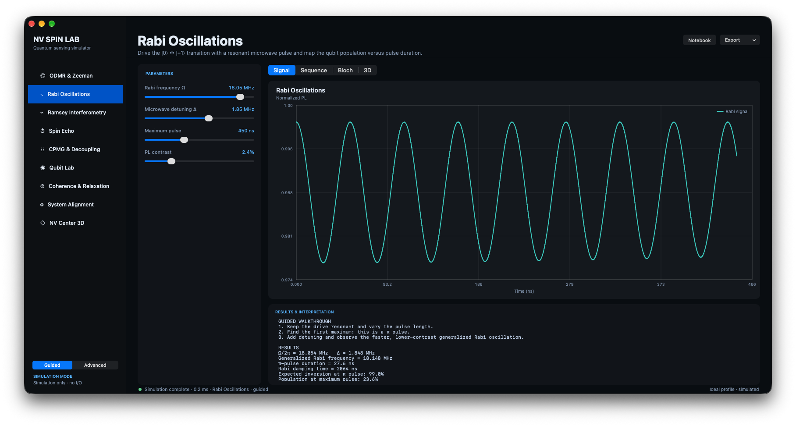

# NV Spin Lab

**NV Spin Lab** is a native macOS teaching application for nitrogen-vacancy (NV) center experiments in diamond. It is written in Objective-C 2.0 with AppKit and is designed for university labs, training programs, and advanced classrooms.



The application is completely unbranded. It contains no vendor names, logos, product names, URLs, contact details, brochure imagery, or trade dress. All diagrams and the 3D model are generated procedurally.

NV Spin Lab is simulation-only. It does not connect to, discover, or control physical instruments, and it performs no hardware I/O.

## Highlights

- Nine navigable experiment areas:
  - ODMR and the Zeeman effect
  - Rabi oscillations
  - Ramsey interferometry
  - Hahn spin echo, symmetric and asymmetric
  - CPMG and dynamical decoupling
  - Single-qubit gates, Bloch sphere, and shot-noise readout
  - Coherence and relaxation (`T1`, `T2*`, `T2`)
  - System alignment and simulated hardware reference
  - Interactive NV-center 3D explorer
- Full spin-1 Hamiltonian with strain, Zeeman coupling, four `<111>` orientations, and `14N` hyperfine structure.
- Live-updating visualizations across every experiment, with a resolved ¹⁴N hyperfine detail inset.
- Quantized energy-level diagrams and multiple ODMR dips, including four-axis ensemble levels.
- Scientific line charts, pulse timelines, Bloch sphere, readout histogram, and a procedural SceneKit diamond lattice.
- Guided mode with a short walkthrough for every experiment, plus an advanced mode that exposes every parameter.
- Built-in **How to Use** guide with workflow and experiment-specific tips.
- Lab notebook with add/show/save/clear actions.
- CSV and JSON data export.
- Report PNG and PDF export.
- `.nvlab` session save/load covering every experiment’s parameters, the current tab, mode, instrument profile, and lab notebook.
- Universal `arm64` + `x86_64` builds with no runtime dependencies.

## Requirements

- macOS 14.0 or later
- Xcode 15 or later with the macOS SDK and command-line tools
- [XcodeGen](https://github.com/yonaskolb/XcodeGen) (`brew install xcodegen`)

The app uses only system frameworks: AppKit, SceneKit, QuartzCore, UniformTypeIdentifiers, and Accelerate.

## Build

```bash
xcodegen generate
xcodebuild -project NVSpinLab.xcodeproj -scheme NVSpinLab \
  -configuration Debug -derivedDataPath build build
open build/Build/Products/Debug/NVSpinLab.app
```

The Debug configuration is built as a universal binary (`arm64` and `x86_64`) because `ONLY_ACTIVE_ARCH` is disabled.

### Release build

```bash
xcodebuild -project NVSpinLab.xcodeproj -scheme NVSpinLab \
  -configuration Release -derivedDataPath build-release \
  ARCHS="arm64 x86_64" ONLY_ACTIVE_ARCH=NO build

lipo -info build-release/Build/Products/Release/NVSpinLab.app/Contents/MacOS/NVSpinLab
open build-release/Build/Products/Release/NVSpinLab.app
```

To distribute the application, sign it with your own Developer ID identity and notarize the resulting bundle. The project intentionally defaults to ad-hoc signing (`CODE_SIGN_IDENTITY = -`) so it can be built locally without a team.

## Tests

```bash
xcodebuild -project NVSpinLab.xcodeproj -scheme NVSpinLab \
  -destination 'platform=macOS' test
```

The physics test target covers:

- Zero-field eigenvalues `{0, D, D}`
- Strain splitting `D ± E`
- Axial Zeeman slopes
- Rabi population at a π pulse and with detuning
- Ramsey fringe period
- Echo refocusing and asymmetric echo behavior
- CPMG filter peak
- Single-NV ODMR line position
- Ensemble levels and hyperfine detail series
- Rabi result contrast
- Signal positivity and level-series sanity checks

## How to use this application

### Quick start

1. Launch **NV Spin Lab**. The app opens on the ODMR experiment and calculates it with the default parameters.
2. Choose an experiment in the left navigator. The current result is recalculated for that experiment.
3. Keep **Guided** mode for the built-in walkthrough, or switch to **Advanced** to expose every parameter.
4. Move any slider or change any pop-up menu. The active tab redraws immediately with the new parameters in every experiment; there is no run button or separate run step.
5. Read the result in the selected tab and in the **Results & Interpretation** panel. In ODMR, the **Signal** tab includes a hyperfine detail inset when ¹⁴N hyperfine is enabled; the **Levels** tab shows all four ⟨111⟩ axes in ensemble mode.
6. Use **Export → Add to notebook** to record a run, or export CSV, JSON, PNG, PDF, or a `.nvlab` session.

NV Spin Lab is a local simulation. No instrument connection, device discovery, or hardware I/O is required.

### In-app help

Choose **Help → How to Use NV Spin Lab** (`⌘?`) for a scrollable guide covering the workflow, tabs, experiment-specific tips, profile choices, notebook, exports, and sessions.

### Experiments and tabs

Choose an experiment in the left navigator and adjust its parameters. Every control updates the active result immediately, including the signal, levels, sequence, 3D model, Bloch sphere, readout histogram, noise response, and decay views. Each experiment exposes relevant tabs:

- **Signal** — measured or simulated signal versus the swept variable
- **Levels** — spin energy levels and avoided crossings
- **Sequence** — laser, microwave, and readout pulse timeline
- **3D** — interactive NV-center model
- **Bloch** — qubit state on the Bloch sphere
- **Readout** — single-shot counts and fidelity estimate
- **Noise** — CPMG filter function and noise spectrum
- **T1** / **T2** — relaxation and coherence decays
- **Hardware** — reference optical and electronic chain

The 3D tab supports drag-to-orbit, scroll-to-zoom, and slow auto-rotation. The magnetic-field vector stays fixed in the laboratory frame while the crystal lattice rotates.

### Guided and advanced modes

**Guided** is the default. It presents a short walkthrough and hides parameters that are less useful for a first pass. **Advanced** exposes every parameter, including detuning, pulse imperfections, noise exponents, shot counts, and readout integration time.

Switch modes with the control at the bottom of the sidebar or with **Simulation → Guided Mode** (`⌘G`).

### Lab notebook

Use **Export → Add to notebook** to record the current experiment, date, visible parameters, and result summary. The notebook panel supports:

- Viewing all entries in the current session
- **Save notebook…** as a plain-text lab record
- **Clear** after confirmation

The notebook is intentionally session-scoped; use the save action or a `.nvlab` session to preserve work.

### Exports

From the **Export** menu or the **File** menu:

- **CSV data…** — the series on the current tab, with parameter metadata as comment lines
- **JSON data…** — experiment metadata, parameters, all series groups, sequence, readout, Bloch state, and metrics
- **PNG report…** — a one-page report with the current visualization and summary
- **PDF report…** — the same report as a vector PDF
- **Save Session…** / **Open Session…** — `.nvlab` JSON sessions that restore every experiment’s parameters, the current tab, mode, profile, and notebook
- **Add to notebook** / **Show notebook…**

### Keyboard shortcuts

| Command | Action |
| --- | --- |
| `⌘S` | Save session |
| `⌘O` | Open session |
| `⌘E` | Export CSV |
| `⌘⇧N` | Show notebook |
| `⌘G` | Toggle guided mode |
| `⌘⇧I` | Toggle ideal instrument profile |
| `⌘?` | Open the How to Use guide |
| `⌘W` | Close window |

## Physics model

The effective spin-1 Hamiltonian in the `{|+1>, |0>, |-1>}` basis is:

```text
H/h = D Sz² + E (Sx² - Sy²) + γ B·S + A I·S
```

Default constants:

| Quantity | Value |
| --- | --- |
| Zero-field splitting `D/h` | `2.870 GHz` |
| Strain splitting `E/h` | adjustable, default `0 MHz` |
| Gyromagnetic ratio `γ` | `2.802 MHz/G` (`g = 2.0023`) |
| `14N` hyperfine `A/h` | `2.16 MHz` |
| NV orientations | four `<111>` axes in ensemble mode |
| Level anti-crossing | near `B = 102.4 mT` |

Units follow the UI: magnetic field in mT, frequency in MHz/GHz, and time in ns or µs. Internally the Hamiltonian is in MHz and fields are converted from mT to gauss.

### Experiment models

- **ODMR:** diagonalizes the spin Hamiltonian across a frequency range, computes transition frequencies and transverse coupling strengths, applies Lorentzian broadening, orientation and hyperfine weights, optical contrast, and Poisson-like noise. All views redraw immediately as controls move; ensemble mode shows all four ⟨111⟩ axes on the Levels tab. A zoomed hyperfine inset resolves the 2.16 MHz ¹⁴N triplet even when the full-trace linewidth is broader than the splitting.
- **Rabi:** effective `{|0>, |+1>}` qubit, `Ω = √2 γ B1`, generalized frequency `√(Ω² + Δ²)`, damped oscillation.
- **Ramsey:** `π/2 - τ - π/2`; fringe frequency equals detuning; Gaussian or Lorentzian envelope set by `T2*`.
- **Spin echo:** `π/2 - τ1 - π - τ2 - π/2`; symmetric echo decay with `T2`; asymmetric mode refocuses only near `τ1 = τ2`.
- **CPMG / DD:** `π/2 - [τ - π - τ] × N - π/2`; coherence versus `N`, filter function, and AC-tone response.
- **Qubit lab:** initialization, X/Y/Z/H/rotation gates, Bloch vector, shot-noise histogram, and readout-fidelity estimate. The Z gate leaves `|0>` unchanged and only affects superpositions.
- **Relaxation:** `T1` recovery, `T2*` Ramsey decay, and `T2` echo decay. The simulator enforces `T2 <= 2 T1` and explains when a requested value was capped.
- **Alignment:** live response curves versus beam overlap with a dashed marker for the current setting; every control changes the response curves or the operating point, alongside estimated PL, ODMR contrast, and SNR.

## Reference hardware profile

The **Reference NV Teaching Kit** profile is generic and simulation-only:

| Subsystem | Nominal limit |
| --- | --- |
| Pulsed laser | `< 5 mW`, rise time approximately `40 ns` |
| Photodetector | finite bandwidth and dark counts |
| Microwave source | `30 dBm`, `1 ns` sampling, `3 MHz – 5.5 GHz` |
| Time tagging | `4 ns` resolution |
| Diamond | NV density approximately `4.5 ppm` |
| Optics | initialization, readout, confocal detection |
| Antenna | microwave loop or stripline |
| Magnet | three-axis Helmholtz coils |

Switch between **Reference** and **Ideal** instrument behavior with **Simulation → Ideal Instrument Profile** (`⌘⇧I`). The ideal profile suppresses detector noise, pulse-error terms, and readout misclassification; material `T1`/`T2` times remain physical and are never bypassed.

## Project layout

```text
NVSpinLab/
  App/
    main.m
    NVAppDelegate.{h,m}
    NVMainWindowController.{h,m}
  Physics/
    NVPhysics.{h,m}       Hamiltonian, experiment generators, hardware description
    NVModels.{h,m}        experiment definitions, parameters, sequences, results
  UI/
    NVWorkspaceViewController.{h,m}
    NVViews.{h,m}         charts, sequence, Bloch, histogram, 3D model
  Resources/
    Info.plist
    AppIcon.icns
  Tests/
    NVPhysicsTests.m
Design/
  AppIcon.iconset/         source image set for the generated app icon
scripts/
  check_branding.sh        source and bundle branding guard
project.yml                XcodeGen project definition
```

## Branding guard

The build runs `scripts/check_branding.sh` before compiling and again on the built bundle. The guard fails if shipped sources or artifacts contain prohibited vendor terms, brochure filenames, PDFs, the exact reference document hash, or any raster image resource other than the generated application icon.

Run it manually:

```bash
scripts/check_branding.sh source
scripts/check_branding.sh bundle build/Build/Products/Debug/NVSpinLab.app
```

The supplied reference material is internal-only and is never copied into the application bundle.

## Simulation-only limitation

NV Spin Lab is a simulation application. It does not connect to, discover, configure, or control physical instruments, and no hardware I/O is performed. The “System Alignment” experiment and “Hardware” tab describe a generic simulated reference setup for teaching. Every result is generated by the physics model.

## Status

Implemented and validated:

- Programmatic AppKit interface, no storyboards
- Nine experiment areas with guided and advanced modes
- Physics tests passing
- Universal Debug and Release builds
- 3D model with snapshot validation
- CSV/JSON/PNG/PDF exports and `.nvlab` sessions
- Branding guard passing for source and built bundle
